# Exploratory data analysis

Snapshot `2026-11-02`, January 2015 to August 2026. Descriptive only: no forecasting model was fitted. Generated by `python run.py phase2`. Tables are in `tables/`.

Jet fuel, diesel and fuel oil cannot be analysed separately from Comtrade, because HS six-digit data merge them in 2710.19. They appear separately only in annual Kyrgyz official sources (section 5). Monthly industrial production was not available for the panel, so it is not analysed.

## 1. Kyrgyz imports over time

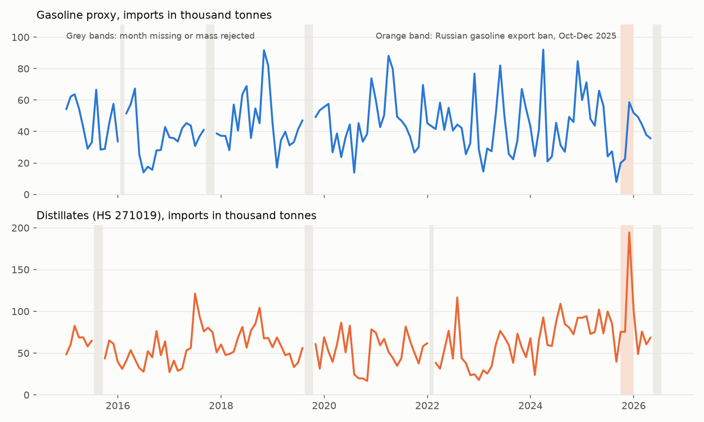

Monthly gasoline swings widely around a stable level, between 21 and 46 thousand tonnes by segment. Distillates rose from 2024.

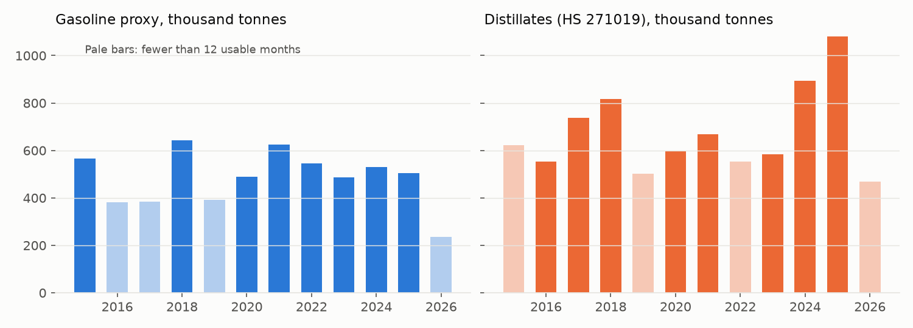

| year | gasoline_kt | distillates_kt | gas_months |
|---|---|---|---|
| 2015 | 566.2 | 621.8 | 12 |
| 2016 | 381.3 | 552.7 | 11 |
| 2017 | 384.3 | 736.3 | 10 |
| 2018 | 642.2 | 816.8 | 12 |
| 2019 | 392.1 | 502.0 | 10 |
| 2020 | 488.3 | 599.8 | 12 |
| 2021 | 623.7 | 667.6 | 12 |
| 2022 | 546.6 | 552.1 | 12 |
| 2023 | 486.6 | 585.0 | 12 |
| 2024 | 529.6 | 894.4 | 12 |
| 2025 | 505.7 | 1,080.2 | 12 |
| 2026 | 235.8 | 468.3 | 6 |

Year-on-year gasoline changes between adjacent full years range from -12% to 28%.

## 2. Seasonality

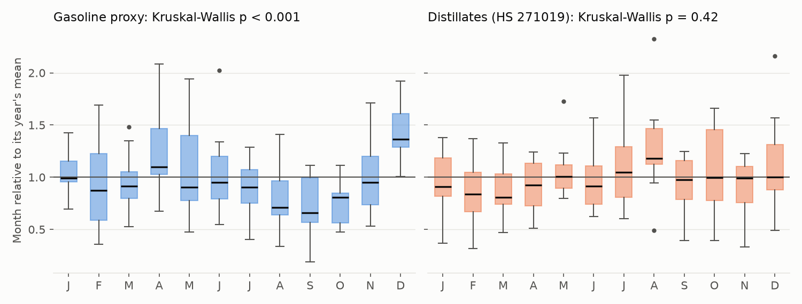

Kyrgyz gasoline varies by month (Kruskal-Wallis p < 0.001): typically highest in Dec (1.36 of the annual mean) and lowest in Sep (0.66). HS 271019 shows no clear monthly pattern (p = 0.42), so seasonal farm demand should be tested, not assumed.

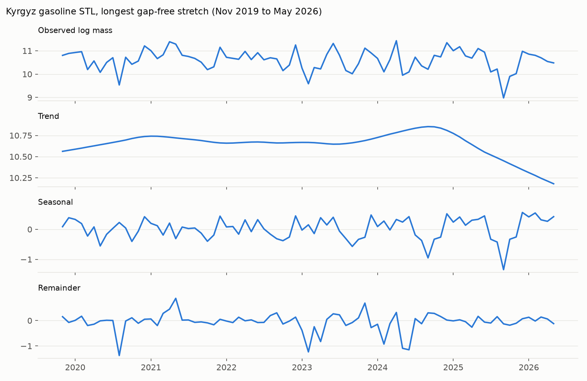

STL needs an unbroken series and targets are not interpolated, so it uses the longest gap-free stretch. Across the panel, median seasonal strength is 0.22 and median trend strength 0.49 on a 0-1 scale, so seasonality is moderate at best. Kyrgyz gasoline: seasonal 0.35, trend 0.09.

## 3. Structural breaks

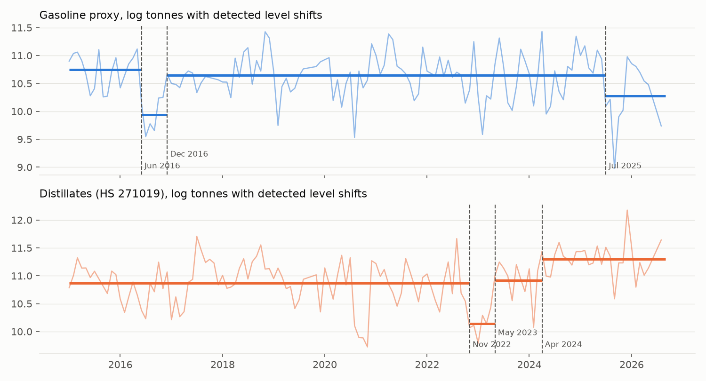

Change points come from PELT on observed log mass, with a minimum segment of 6 months. They describe level shifts and do not prove causes.

| iso3 | product_group | start | months | mean_kt |
|---|---|---|---|---|
| KGZ | gasoline | 2015-01 | 16 | 46.4 |
| KGZ | gasoline | 2016-06 | 6 | 20.6 |
| KGZ | gasoline | 2016-12 | 99 | 42.2 |
| KGZ | gasoline | 2025-07 | 12 | 29.0 |
| KGZ | middle_heavy | 2015-01 | 89 | 52.4 |
| KGZ | middle_heavy | 2022-11 | 6 | 25.3 |
| KGZ | middle_heavy | 2023-05 | 11 | 55.1 |
| KGZ | middle_heavy | 2024-04 | 27 | 80.9 |

The gasoline shift from July 2025 coincides with the Russian restrictions, and also with the months where Comtrade holds first-release data (section 5), so its size is uncertain. Detected breaks across the panel, by year:

| year | breaks |
|---|---|
| 2015 | 7 |
| 2016 | 25 |
| 2017 | 15 |
| 2018 | 8 |
| 2019 | 17 |
| 2020 | 25 |
| 2021 | 21 |
| 2022 | 23 |
| 2023 | 16 |
| 2024 | 8 |
| 2025 | 7 |
| 2026 | 3 |

## 4. Country comparison

Absolute tonnes mainly reflect country size, so volumes are shown per person.

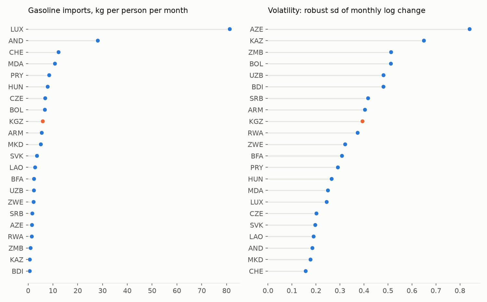

Imports are not consumption: the high figures for Luxembourg and Andorra probably include fuel sold to non-residents, which these data cannot confirm. Kyrgyz gasoline volatility (robust sd of monthly log change 0.39) ranks 14 of 22, against a panel median of 0.32. Lag-12 autocorrelation of log mass has a median of 0.20, which matches the weak seasonal strength. Series co-move little: the median pairwise correlation of year-on-year gasoline changes is 0.04, and 0.01 for Kyrgyzstan.

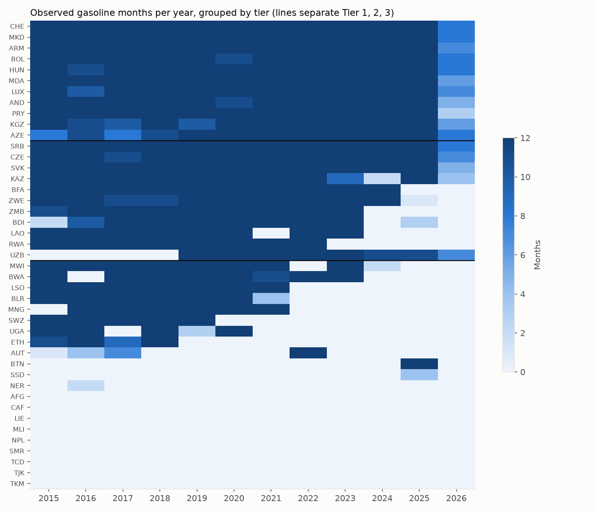

## 5. Kyrgyz validation

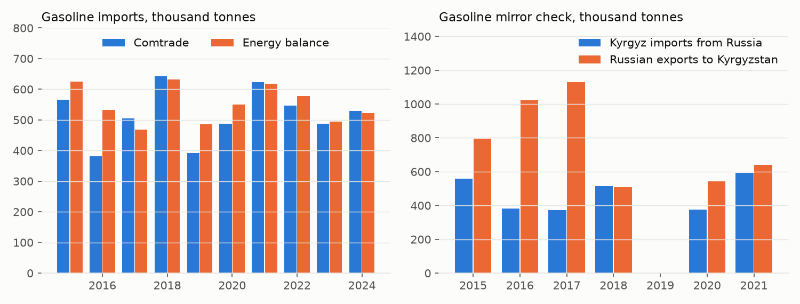

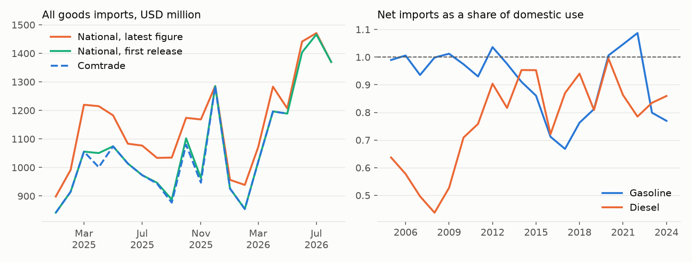

Full comparison tables and explanations are in `kyrgyz_validation.md`.

## 6. Supplier concentration

Concentration says how few suppliers a country uses. It does not say how much of its fuel is imported.

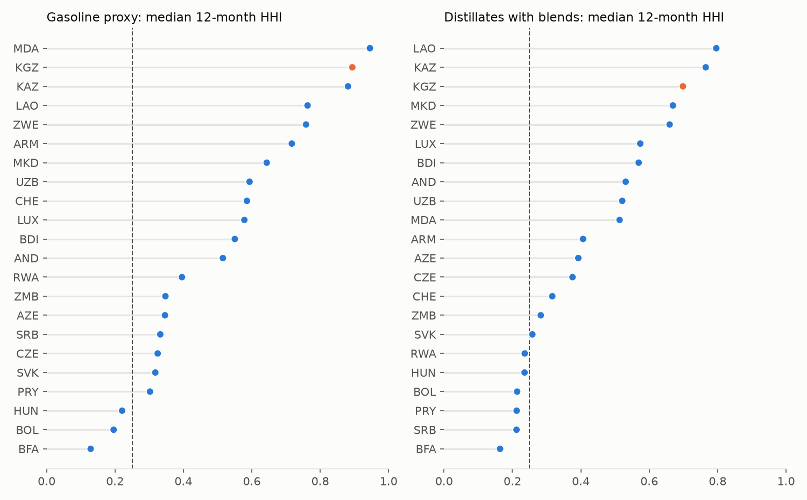

Kyrgyz gasoline has a median 12-month HHI of 0.89, among the highest in the panel (median 0.53). The dashed line marks 0.25, a common threshold for high concentration in competition analysis, used here for reference only.

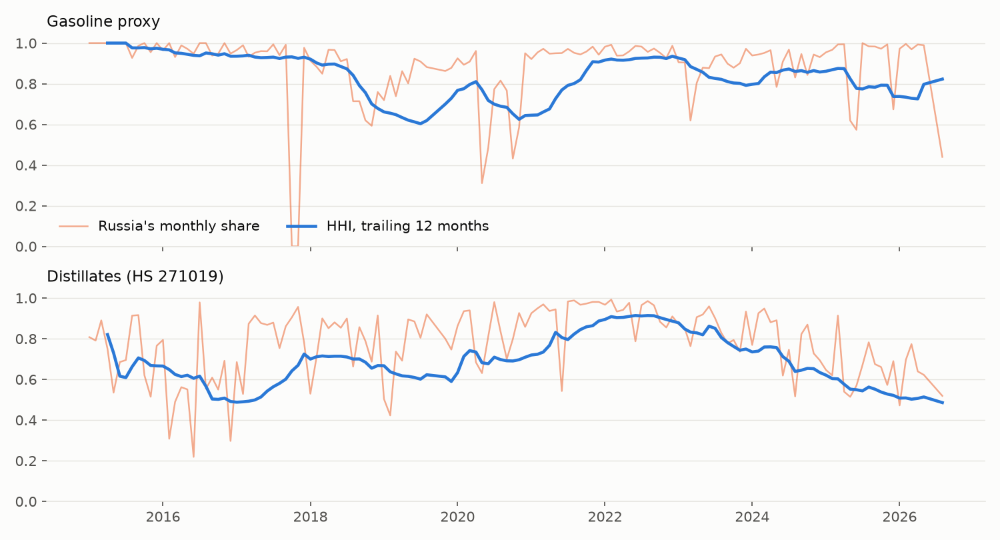

Trailing HHI for Kyrgyz gasoline stays high in most years, so it offers limited variation as a predictor; this is what hypothesis H4 needs to test.

## 7. External indicators

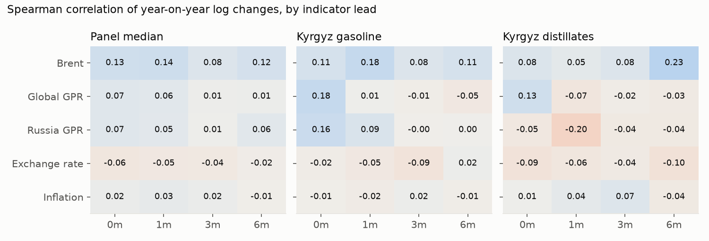

Correlations use year-on-year log changes across 44 series, with leads of 0, 1, 3 and 6 months.

| indicator | lag_months | median_rho | series | positive | significant_after_bh |
|---|---|---|---|---|---|
| Brent | 0 | 0.13 | 44 | 31 | 14 |
| Brent | 1 | 0.14 | 44 | 30 | 14 |
| Brent | 3 | 0.08 | 44 | 31 | 12 |
| Brent | 6 | 0.12 | 44 | 28 | 8 |
| Exchange rate | 0 | -0.06 | 42 | 16 | 6 |
| Exchange rate | 1 | -0.05 | 42 | 18 | 8 |
| Exchange rate | 3 | -0.04 | 42 | 19 | 9 |
| Exchange rate | 6 | -0.02 | 40 | 18 | 9 |
| Global GPR | 0 | 0.07 | 44 | 29 | 5 |
| Global GPR | 1 | 0.06 | 44 | 29 | 6 |
| Global GPR | 3 | 0.01 | 44 | 26 | 8 |
| Global GPR | 6 | 0.01 | 44 | 24 | 4 |
| Inflation | 0 | 0.02 | 42 | 23 | 7 |
| Inflation | 1 | 0.03 | 42 | 26 | 7 |
| Inflation | 3 | 0.02 | 42 | 26 | 5 |
| Inflation | 6 | -0.01 | 42 | 19 | 5 |
| Russia GPR | 0 | 0.07 | 44 | 27 | 6 |
| Russia GPR | 1 | 0.05 | 44 | 30 | 7 |
| Russia GPR | 3 | 0.01 | 44 | 22 | 8 |
| Russia GPR | 6 | 0.06 | 44 | 33 | 7 |

155 of 862 tests pass a Benjamini-Hochberg 5% threshold, but overlapping year-on-year windows make p-values too small, and the signs vary by country. **For Kyrgyzstan, 0 of 40 pass**; the strongest is rho = 0.23. GDP: 0 of 39 country-product series have an annual GDP correlation with p < 0.05, using few annual points. Correlation is not causation, and weak linear association does not rule out a role during shocks.

## 8. Shortfall labels recomputed

This repeats the proposal's descriptive rule (trailing three-month mass under 0.75 of the same months in the previous three years).

| product_group | mass_basis | evaluable_months | flagged_months | episodes | first_months |
|---|---|---|---|---|---|
| gasoline | clean | 112 | 27 | 11 | 2016-08, 2017-03, 2018-03, 2019-05, 2020-06, 2020-08, 2020-10, 2021-11, 2023-02, 2024-07, 2025-09 |
| gasoline | as_in_proposal | 119 | 27 | 11 | 2016-03, 2016-08, 2017-04, 2017-11, 2019-05, 2020-06, 2020-08, 2021-11, 2023-02, 2024-07, 2025-09 |
| middle_heavy | clean | 112 | 22 | 7 | 2016-03, 2017-03, 2019-07, 2020-09, 2021-06, 2022-05, 2022-12 |
| middle_heavy | as_in_proposal | 119 | 27 | 8 | 2016-03, 2017-03, 2018-09, 2019-07, 2020-09, 2021-06, 2022-05, 2022-12 |

The rule gives 11 gasoline and 7 distillate episodes on clean data, against the proposal's 11 and 8. Dates move, so the labels still need checking against documented events. Sep 2025 and later are affected by the first-release issue.
