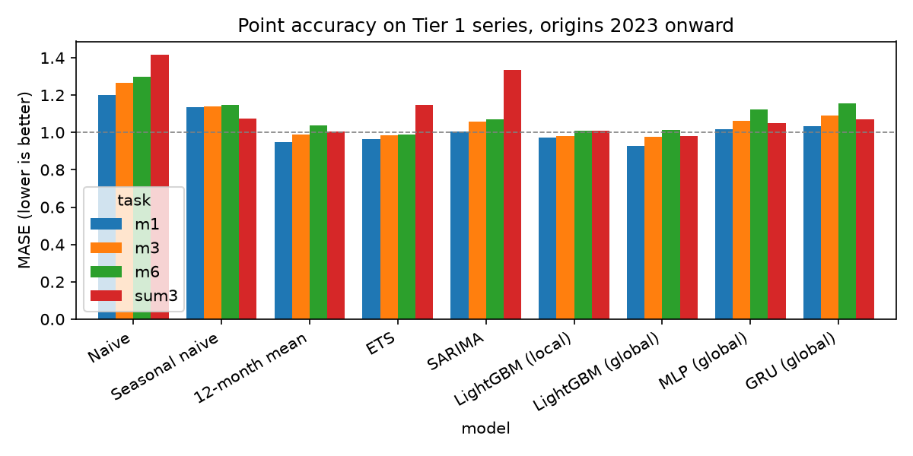
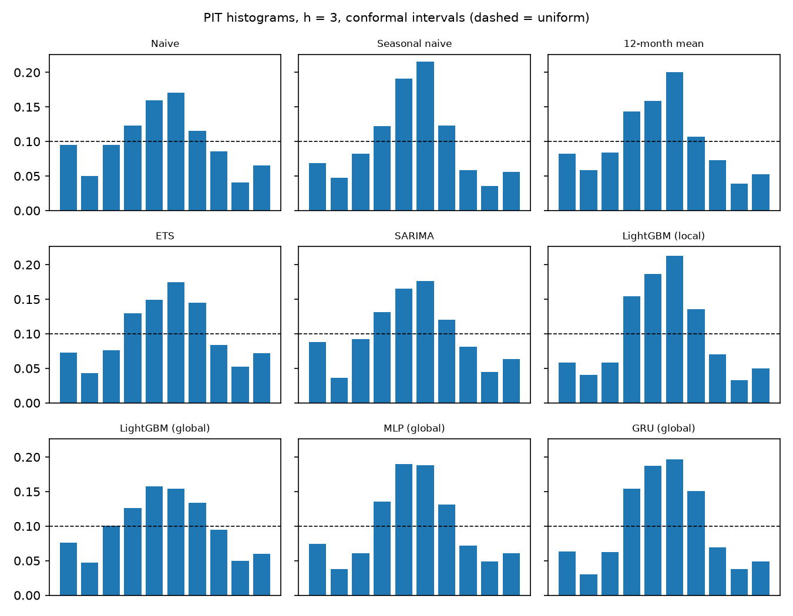

# Phase 3 results: forecasting and shortfall risk

Generated by `python run.py evaluate` (rules v1.0). Rolling origins from 2023-01-01 to 2026-07-01
(43 monthly origins), Tier 1 series unless stated. Every number below is computed from
`data/modeling/forecasts_raw.parquet`; the tables are in `tables/` and the figures in `figures/`.

Forecasts use only data released by each origin. Intervals are conformally adjusted on the 24 previous origins.
MASE is scaled by each series' in-sample seasonal difference, so 1.0 equals the historical error of a
seasonal-naive forecast; values below 1 are better.

## Hypotheses

Holm-adjusted p-values over the four primary tests. Null results are reported with the same weight as positive ones.
Result is the relative improvement of the first model over the second: positive means the first model is better, negative means worse.
p is one-sided (first model better).

| Hypothesis | Test | Result | p (raw) | p (Holm) | Verdict |
|---|---|---|---|---|---|
| H1: global cuts Kyrgyz MASE ≥5% vs best local, h=3 | LightGBM global vs LightGBM, local | -13.8% (95% CI -26.0% to +1.5%) | 0.943 | 1.000 | **not supported** |
| H2: neural not better overall, better in shock windows | MLP, global vs LightGBM global, MASE h=3 | overall -12.0% (p=0.980); shock -12.1% on 111 cases | 0.999 | 1.000 | **not supported** |
| H3: supplier + shock data cut pinball ≥3% on high-dependence series | LightGBM global vs own-history LightGBM | +4.5% (95% CI -3.0% to +12.4%) | 0.163 | 0.490 | **not supported** |
| H4: forecast probability beats HHI ranking | PR-AUC and recall at 10% alert budget | PR-AUC 0.190 vs 0.065 (base rate 0.074); recall 0.30 vs 0.08 | <0.001 | <0.001 | **supported** |

High-dependence series for H3 (largest supplier ≥70% before 2023): ARM:gasoline, AZE:gasoline, CHE:gasoline, KAZ:middle_incl_blends, KGZ:gasoline, KGZ:middle_incl_blends, LAO:gasoline, LAO:middle_incl_blends, LUX:middle_incl_blends, MDA:gasoline, MKD:gasoline, MKD:middle_incl_blends, RWA:gasoline, ZMB:gasoline, ZMB:middle_incl_blends, ZWE:gasoline, ZWE:middle_incl_blends.
The neural candidate for H2 (MLP, global) was chosen on the 2021-2022 calibration origins, before the test block.
Shock windows are documented supply-shortfall events from `config/shock_events.csv` plus two months; the test block has
104 shock cases at h=3, so H2's shock comparison has low power.

## Point accuracy (MASE)

Cases where every model produced a forecast.

| model | m1 | m3 | m6 | sum3 |
|---|---|---|---|---|
| Naive | 1.200 | 1.264 | 1.297 | 1.416 |
| Seasonal naive | 1.136 | 1.137 | 1.148 | 1.075 |
| 12-month mean | 0.947 | 0.989 | 1.036 | 1.006 |
| ETS | 0.964 | 0.983 | 0.990 | 1.148 |
| SARIMA | 1.007 | 1.059 | 1.069 | 1.335 |
| LightGBM, local | 0.974 | 0.982 | 1.011 | 1.009 |
| LightGBM, global | 0.929 | 0.976 | 1.015 | 0.981 |
| MLP, global | 1.017 | 1.064 | 1.121 | 1.049 |
| GRU, global | 1.032 | 1.092 | 1.154 | 1.072 |

## Probabilistic accuracy and calibration, h = 3

Pinball loss is scaled like MASE. Coverage should be close to 0.80 and 0.95.

| model | pinball | cover80_raw | cover80 | cover95_raw | cover95 | width80 |
|---|---|---|---|---|---|---|
| Naive | 1.795 | 0.791 | 0.840 | 0.946 | 0.991 | 23.304 |
| Seasonal naive | 2.460 | 0.825 | 0.875 | 0.946 | 0.985 | 30.984 |
| 12-month mean | 1.313 | 0.805 | 0.864 | 0.962 | 0.992 | 19.799 |
| ETS | 0.404 | 0.862 | 0.855 | 0.962 | 0.966 | 7.203 |
| SARIMA | 0.472 | 0.885 | 0.848 | 0.959 | 0.972 | 8.824 |
| LightGBM, local | 0.305 | 0.371 | 0.892 | 0.641 | 0.981 | 5.203 |
| LightGBM, global | 0.244 | 0.672 | 0.864 | 0.897 | 0.978 | 3.925 |
| MLP, global | 0.315 | 0.485 | 0.864 | 0.672 | 0.981 | 5.301 |
| GRU, global | 0.335 | 0.489 | 0.888 | 0.705 | 0.986 | 5.832 |

## Normal and shock windows, h = 3 (MASE)

| model | normal | shock |
|---|---|---|
| Naive | 1.253 | 1.327 |
| Seasonal naive | 1.086 | 1.450 |
| 12-month mean | 0.976 | 1.070 |
| ETS | 0.947 | 1.204 |
| SARIMA | 0.988 | 1.489 |
| LightGBM, local | 0.951 | 1.170 |
| LightGBM, global | 0.963 | 1.053 |
| MLP, global | 1.046 | 1.174 |
| GRU, global | 1.071 | 1.216 |

## Shortfall warnings (H4 and sensitivity)

Shortfall: the next-three-month mean falls below the threshold share of its seasonal baseline (proposal eq. 2).
The probability comes from the conformal LightGBM forecast distribution (eq. 3); HHI is the trailing 12-month index at the origin.

| Label | Positives / cases | PR-AUC forecast | PR-AUC HHI | PR-AUC top-supplier share | Brier | Recall forecast | Recall HHI | p |
|---|---|---|---|---|---|---|---|---|
| flag_75 | 64 / 861 | 0.190 | 0.065 | 0.090 | 0.081 | 0.30 | 0.08 | <0.001 |
| flag_70 | 45 / 861 | 0.148 | 0.048 | 0.066 | 0.061 | 0.31 | 0.09 | 0.006 |
| flag_80 | 95 / 861 | 0.234 | 0.089 | 0.106 | 0.110 | 0.25 | 0.06 | <0.001 |
| supply_side | 34 / 861 | 0.098 | 0.037 | 0.055 | 0.068 | 0.32 | 0.06 | 0.113 |
| shock | 126 / 861 | 0.387 | 0.107 | 0.129 | 0.109 | 0.30 | 0.00 | <0.001 |

`flag_75` is the primary label; `flag_70` and `flag_80` change the threshold; `supply_side` adds the unit-value condition;
`shock` uses the documented event calendar instead of the volume rule. The Phase 2 event check found the volume labels a weak
proxy (`reports/phase2/event_validation.md`), so the event-based row matters as much as the primary one.

Ranking and calibration are separate properties. The reliability diagram shows whether a stated probability matches
the observed frequency; a Brier score above the base-rate Brier (base rate × (1 − base rate)) means the probabilities
are worse than always predicting the base rate, even if they rank cases well.

### Recalibrated probabilities (post-hoc extension, not part of H1-H4)

Added on 2026-11-25 after the reliability diagram showed overstated risk (`docs/decision_log.md`). Platt scaling on past
outcomes that had been released by each origin, pooled over all 44 series and 24 origins. *Rolling* refits the map every
origin; *fixed* fits it once at the first test origin and keeps it. Same cases for all three rows.

| Label | Probability | Mean p | Base rate | Brier | Base-rate Brier | PR-AUC | Recall |
|---|---|---|---|---|---|---|---|
| flag_75 | raw | 0.171 | 0.074 | 0.0806 | 0.0688 | 0.190 | 0.30 |
| flag_75 | rolling | 0.100 | 0.074 | 0.0697 | 0.0688 | 0.137 | 0.22 |
| flag_75 | fixed | 0.140 | 0.074 | 0.0688 | 0.0688 | 0.190 | 0.30 |
| flag_70 | raw | 0.136 | 0.052 | 0.0612 | 0.0495 | 0.148 | 0.31 |
| flag_70 | rolling | 0.076 | 0.052 | 0.0511 | 0.0495 | 0.106 | 0.22 |
| flag_70 | fixed | 0.109 | 0.052 | 0.0504 | 0.0495 | 0.148 | 0.31 |
| flag_80 | raw | 0.214 | 0.110 | 0.1104 | 0.0982 | 0.234 | 0.25 |
| flag_80 | rolling | 0.134 | 0.110 | 0.0972 | 0.0982 | 0.186 | 0.22 |
| flag_80 | fixed | 0.183 | 0.110 | 0.0979 | 0.0982 | 0.234 | 0.25 |

Recalibration removes most of the overstatement, but no version is meaningfully better than the base rate on the
Brier score (the largest gain is about 0.001): the forecast carries ranking information, not a reliable probability level. The rolling map is monotone within an
origin, so it keeps each month's ranking (what the monitor shows); refitting changes the scale between origins,
which lowers the pooled PR-AUC. The monitor shows the rolling recalibrated probability.

## Further scores and calibration checks

Added 2026-11-25; they do not change any number above. Same cases as the accuracy table (every model forecast the case).
MAE, RMSE (tonnes) and WAPE are pooled over series, so large importers dominate them; MASE and RMSSE are scaled per series.
CRPS is approximated from the five stored quantiles (2 x weighted pinball loss, scaled like MASE). It runs below the exact CRPS
(about 11% for a normal forecast) because the tails are coarse, so use it to rank models, not for its absolute level.
`CRPS_raw` uses the raw (non-conformal) intervals.

### Point and distribution scores, h = 3

| model | MASE | RMSSE | MAE_t | RMSE_t | WAPE | CRPS | CRPS_raw | n |
|---|---|---|---|---|---|---|---|---|
| Naive | 1.264 | 1.699 | 23,037 | 33,918 | 0.244 | 2.403 | 1.946 | 738 |
| Seasonal naive | 1.137 | 1.582 | 22,145 | 34,535 | 0.235 | 3.041 | 2.434 | 738 |
| 12-month mean | 0.989 | 1.325 | 18,657 | 27,916 | 0.198 | 1.878 | 1.540 | 738 |
| ETS | 0.983 | 1.342 | 20,122 | 31,734 | 0.213 | 0.872 | 0.856 | 738 |
| SARIMA | 1.059 | 1.472 | 21,711 | 35,285 | 0.230 | 0.996 | 0.991 | 738 |
| LightGBM, local | 0.982 | 1.349 | 19,203 | 30,081 | 0.203 | 0.733 | 0.729 | 738 |
| LightGBM, global | 0.976 | 1.306 | 19,063 | 28,943 | 0.202 | 0.654 | 0.630 | 738 |
| MLP, global | 1.064 | 1.465 | 20,959 | 32,314 | 0.222 | 0.780 | 0.761 | 738 |
| GRU, global | 1.092 | 1.513 | 21,587 | 33,051 | 0.229 | 0.816 | 0.774 | 738 |

### Point and distribution scores, h = 1

| model | MASE | RMSSE | MAE_t | RMSE_t | WAPE | CRPS | CRPS_raw | n |
|---|---|---|---|---|---|---|---|---|
| Naive | 1.200 | 1.606 | 22,224 | 33,288 | 0.236 | 1.830 | 1.663 | 778 |
| Seasonal naive | 1.136 | 1.584 | 22,458 | 35,170 | 0.239 | 3.294 | 2.717 | 778 |
| 12-month mean | 0.947 | 1.282 | 17,939 | 27,450 | 0.191 | 0.987 | 0.879 | 778 |
| ETS | 0.964 | 1.324 | 19,799 | 31,290 | 0.210 | 0.756 | 0.747 | 778 |
| SARIMA | 1.007 | 1.389 | 20,565 | 33,033 | 0.219 | 0.851 | 0.847 | 778 |
| LightGBM, local | 0.974 | 1.308 | 19,036 | 28,932 | 0.202 | 0.699 | 0.709 | 778 |
| LightGBM, global | 0.929 | 1.238 | 18,336 | 27,967 | 0.195 | 0.619 | 0.606 | 778 |
| MLP, global | 1.017 | 1.356 | 20,343 | 30,743 | 0.216 | 0.730 | 0.720 | 778 |
| GRU, global | 1.032 | 1.393 | 20,831 | 31,758 | 0.221 | 0.753 | 0.729 | 778 |

### Point and distribution scores, h = 6

| model | MASE | RMSSE | MAE_t | RMSE_t | WAPE | CRPS | CRPS_raw | n |
|---|---|---|---|---|---|---|---|---|
| Naive | 1.297 | 1.761 | 23,631 | 35,820 | 0.250 | 1.929 | 1.627 | 678 |
| Seasonal naive | 1.148 | 1.576 | 21,594 | 32,348 | 0.228 | 3.688 | 2.773 | 678 |
| 12-month mean | 1.036 | 1.383 | 19,264 | 28,311 | 0.204 | 3.739 | 2.951 | 678 |
| ETS | 0.990 | 1.336 | 20,366 | 32,015 | 0.215 | 1.139 | 1.106 | 678 |
| SARIMA | 1.069 | 1.494 | 22,081 | 35,949 | 0.233 | 1.276 | 1.268 | 678 |
| LightGBM, local | 1.011 | 1.397 | 19,696 | 31,395 | 0.208 | 0.761 | 0.756 | 678 |
| LightGBM, global | 1.015 | 1.358 | 19,436 | 29,049 | 0.205 | 0.683 | 0.653 | 678 |
| MLP, global | 1.121 | 1.522 | 22,133 | 34,944 | 0.234 | 0.844 | 0.796 | 678 |
| GRU, global | 1.154 | 1.606 | 22,790 | 36,696 | 0.241 | 0.890 | 0.827 | 678 |

### Point and distribution scores, months 1-3 total

| model | MASE | RMSSE | MAE_t | RMSE_t | WAPE | CRPS | CRPS_raw | n |
|---|---|---|---|---|---|---|---|---|
| Naive | 1.416 | 1.910 | 19,313 | 28,948 | 0.204 | 2.500 | 2.006 | 732 |
| Seasonal naive | 1.075 | 1.478 | 16,892 | 26,978 | 0.178 | 3.066 | 2.423 | 732 |
| 12-month mean | 1.006 | 1.341 | 14,588 | 21,573 | 0.154 | 1.941 | 1.597 | 732 |
| ETS | 1.148 | 1.677 | 17,001 | 28,000 | 0.179 | 0.965 | 0.940 | 732 |
| SARIMA | 1.335 | 2.014 | 19,925 | 33,177 | 0.210 | 1.159 | 1.147 | 732 |
| LightGBM, local | 1.009 | 1.388 | 15,320 | 23,654 | 0.161 | 0.764 | 0.732 | 732 |
| LightGBM, global | 0.981 | 1.304 | 14,998 | 22,840 | 0.158 | 0.665 | 0.634 | 732 |
| MLP, global | 1.049 | 1.427 | 16,071 | 25,031 | 0.169 | 0.789 | 0.749 | 732 |
| GRU, global | 1.072 | 1.482 | 16,539 | 25,021 | 0.174 | 0.832 | 0.766 | 732 |

### Coverage by horizon (nominal 0.80 and 0.95)

`m1`

| model | cover80_raw | cover80 | cover95_raw | cover95 | n |
|---|---|---|---|---|---|
| Naive | 0.797 | 0.835 | 0.943 | 0.994 | 778 |
| Seasonal naive | 0.815 | 0.866 | 0.946 | 0.986 | 778 |
| 12-month mean | 0.808 | 0.861 | 0.963 | 0.991 | 778 |
| ETS | 0.851 | 0.842 | 0.954 | 0.967 | 778 |
| SARIMA | 0.870 | 0.832 | 0.960 | 0.968 | 778 |
| LightGBM, local | 0.395 | 0.877 | 0.668 | 0.991 | 778 |
| LightGBM, global | 0.683 | 0.856 | 0.904 | 0.970 | 778 |
| MLP, global | 0.492 | 0.857 | 0.694 | 0.976 | 778 |
| GRU, global | 0.509 | 0.875 | 0.695 | 0.979 | 778 |

`m3`

| model | cover80_raw | cover80 | cover95_raw | cover95 | n |
|---|---|---|---|---|---|
| Naive | 0.791 | 0.840 | 0.946 | 0.991 | 738 |
| Seasonal naive | 0.825 | 0.875 | 0.946 | 0.985 | 738 |
| 12-month mean | 0.805 | 0.864 | 0.962 | 0.992 | 738 |
| ETS | 0.862 | 0.855 | 0.962 | 0.966 | 738 |
| SARIMA | 0.885 | 0.848 | 0.959 | 0.972 | 738 |
| LightGBM, local | 0.371 | 0.892 | 0.641 | 0.981 | 738 |
| LightGBM, global | 0.672 | 0.864 | 0.897 | 0.978 | 738 |
| MLP, global | 0.485 | 0.864 | 0.672 | 0.981 | 738 |
| GRU, global | 0.489 | 0.888 | 0.705 | 0.986 | 738 |

`m6`

| model | cover80_raw | cover80 | cover95_raw | cover95 | n |
|---|---|---|---|---|---|
| Naive | 0.805 | 0.863 | 0.947 | 0.996 | 678 |
| Seasonal naive | 0.845 | 0.882 | 0.947 | 0.991 | 678 |
| 12-month mean | 0.811 | 0.889 | 0.956 | 0.991 | 678 |
| ETS | 0.900 | 0.875 | 0.975 | 0.985 | 678 |
| SARIMA | 0.903 | 0.861 | 0.972 | 0.988 | 678 |
| LightGBM, local | 0.385 | 0.891 | 0.624 | 0.987 | 678 |
| LightGBM, global | 0.690 | 0.879 | 0.903 | 0.984 | 678 |
| MLP, global | 0.497 | 0.885 | 0.667 | 0.991 | 678 |
| GRU, global | 0.490 | 0.894 | 0.664 | 0.994 | 678 |

`sum3`

| model | cover80_raw | cover80 | cover95_raw | cover95 | n |
|---|---|---|---|---|---|
| Naive | 0.805 | 0.865 | 0.939 | 0.993 | 732 |
| Seasonal naive | 0.851 | 0.893 | 0.926 | 0.985 | 732 |
| 12-month mean | 0.833 | 0.891 | 0.932 | 0.992 | 732 |
| ETS | 0.866 | 0.883 | 0.973 | 0.981 | 732 |
| SARIMA | 0.865 | 0.866 | 0.963 | 0.986 | 732 |
| LightGBM, local | 0.437 | 0.906 | 0.727 | 0.988 | 732 |
| LightGBM, global | 0.668 | 0.892 | 0.917 | 0.978 | 732 |
| MLP, global | 0.488 | 0.892 | 0.680 | 0.984 | 732 |
| GRU, global | 0.501 | 0.906 | 0.680 | 0.986 | 732 |

Cases overlap across origins and series, so coverage differences of a few points are within noise.

### Quantile calibration, h = 3

Share of outcomes below each conformal quantile; the ideal equals the level.

| model | hit_q025 | hit_q100 | hit_q500 | hit_q900 | hit_q975 |
|---|---|---|---|---|---|
| Naive | 0.007 | 0.095 | 0.523 | 0.935 | 0.997 |
| Seasonal naive | 0.004 | 0.069 | 0.512 | 0.944 | 0.989 |
| 12-month mean | 0.004 | 0.083 | 0.527 | 0.947 | 0.996 |
| ETS | 0.014 | 0.073 | 0.472 | 0.928 | 0.980 |
| SARIMA | 0.016 | 0.088 | 0.514 | 0.936 | 0.988 |
| LightGBM, local | 0.012 | 0.058 | 0.499 | 0.950 | 0.993 |
| LightGBM, global | 0.008 | 0.076 | 0.507 | 0.940 | 0.986 |
| MLP, global | 0.014 | 0.075 | 0.499 | 0.939 | 0.995 |
| GRU, global | 0.012 | 0.064 | 0.497 | 0.951 | 0.999 |

### PIT, h = 3

Share of PIT values in the two outer deciles (ideal 0.20; above it means outcomes fall outside the forecast distribution too often). With five stored quantiles the PIT is interpolated, so read the tails and the overall shape only. Full histograms: `tables/pit.csv`.

| model | tails | bin1 | bin2 | bin5 | bin6 | bin9 | bin10 | n |
|---|---|---|---|---|---|---|---|---|
| Naive | 0.160 | 0.095 | 0.050 | 0.160 | 0.171 | 0.041 | 0.065 | 738 |
| Seasonal naive | 0.125 | 0.069 | 0.047 | 0.191 | 0.215 | 0.035 | 0.056 | 738 |
| 12-month mean | 0.136 | 0.083 | 0.058 | 0.159 | 0.201 | 0.039 | 0.053 | 738 |
| ETS | 0.145 | 0.073 | 0.043 | 0.149 | 0.175 | 0.053 | 0.072 | 738 |
| SARIMA | 0.152 | 0.088 | 0.037 | 0.165 | 0.176 | 0.045 | 0.064 | 738 |
| LightGBM, local | 0.108 | 0.058 | 0.041 | 0.187 | 0.213 | 0.033 | 0.050 | 738 |
| LightGBM, global | 0.136 | 0.076 | 0.047 | 0.157 | 0.154 | 0.050 | 0.060 | 738 |
| MLP, global | 0.136 | 0.075 | 0.038 | 0.190 | 0.188 | 0.049 | 0.061 | 738 |
| GRU, global | 0.112 | 0.064 | 0.030 | 0.187 | 0.196 | 0.038 | 0.049 | 738 |

### Quantile crossing

Share of forecast rows whose quantiles were out of order before sorting. `crossed_learner` is the learner's own output (recorded only for forecasts produced after this diagnostic was added; n/a otherwise); `crossed_conformal` is the share after the conformal shift. Sorted quantiles are what every score above uses.

| model | rows | crossed_learner | crossed_conformal |
|---|---|---|---|
| abl_from_2018 | 5310 | n/a | 0.0000 |
| abl_no_external | 5310 | n/a | 0.0004 |
| abl_no_shock | 5310 | n/a | 0.0015 |
| abl_no_supplier | 5310 | n/a | 0.0009 |
| abl_no_uv | 5310 | n/a | 0.0002 |
| abl_own_history | 5310 | n/a | 0.0004 |
| abl_strict_importers | 5310 | n/a | 0.0000 |
| abl_train_to_2021 | 5310 | n/a | 0.0000 |
| abl_without_kgz | 5310 | n/a | 0.0002 |
| ETS | 4769 | n/a | 0.0000 |
| GRU, global | 5310 | n/a | 0.0000 |
| LightGBM, global | 5310 | n/a | 0.0004 |
| LightGBM, local | 4842 | n/a | 0.0000 |
| 12-month mean | 5310 | n/a | 0.0000 |
| MLP, global | 5310 | n/a | 0.0000 |
| Naive | 5310 | n/a | 0.0000 |
| SARIMA | 5310 | n/a | 0.0000 |
| Seasonal naive | 5310 | n/a | 0.0000 |

## Ablation (LightGBM global, h = 3)

One change at a time. Positive change means the variant is worse than the full model.
`abl_without_kgz` is scored on Kyrgyz series only (leave-one-country-out); `abl_strict_importers` on strict-importer series only.
`abl_no_conformal` compares raw with conformal intervals of the same model, so its MASE does not change.

| variant | cases | mase_change | pinball_change | cover80 |
|---|---|---|---|---|
| abl_from_2018 | 867 | -0.1% | +0.3% | 0.877 |
| abl_no_external | 867 | -1.4% | +3.6% | 0.879 |
| abl_no_shock | 867 | +1.1% | +2.7% | 0.869 |
| abl_no_supplier | 867 | -2.4% | -0.1% | 0.860 |
| abl_no_uv | 867 | -0.3% | +1.9% | 0.862 |
| abl_own_history | 867 | -3.1% | +3.7% | 0.886 |
| abl_strict_importers | 540 | -0.3% | +16.5% | 0.935 |
| abl_train_to_2021 | 867 | -2.6% | -2.4% | 0.877 |
| abl_without_kgz | 78 | +2.2% | +3.8% | 0.744 |
| abl_no_conformal | 867 | +0.0% | -9.1% | 0.675 |
| abl_local_training |  | +0.8% | +24.9% | 0.893 |

## Kyrgyzstan

Per-product accuracy for Kyrgyzstan: `tables/accuracy_kyrgyzstan.csv`.

## Exploratory: H4 benchmarks and strata (R1, R2)

Added 2026-11-25 after the primary results were seen (`docs/decision_log.md`). **Exploratory: these are not Holm-adjusted primary tests,
and H1-H4 above are unchanged.** Same Tier-1 next-three-month cases and label (`flag_75`) as H4, scored with the LightGBM (global) shortfall
probability. Each row compares it with one other score on the cases both cover, so case counts differ by row (the local models do not forecast
every case). Difference is PR-AUC(LightGBM) minus PR-AUC(benchmark), with the same moving-block bootstrap as H4 (blocks of 6 origins, 2000
resamples); p is one-sided, the share of resamples with a difference at or below zero. The persistence rule scores a case by the last
visible three-month ratio Q/B at the origin (the latest three consecutive months public by the end of the origin month against their as-of
seasonal baseline; lower ratio = higher risk), built only from data released by the origin. Recall is at a 10% alert budget on the shared cases.

### R1: secondary benchmarks, all Tier-1 series

| Benchmark | Cases | Positives | PR-AUC LightGBM | PR-AUC benchmark | Difference (95% CI) | p (one-sided) | Recall@10% LightGBM | Recall@10% benchmark |
|---|---|---|---|---|---|---|---|---|
| Naive | 861 | 64 | 0.190 | 0.165 | +0.025 (-0.018 to +0.137) | 0.096 | 0.30 | 0.23 |
| Seasonal naive | 861 | 64 | 0.190 | 0.150 | +0.040 (-0.047 to +0.160) | 0.233 | 0.30 | 0.28 |
| 12-month mean | 861 | 64 | 0.190 | 0.152 | +0.038 (-0.018 to +0.147) | 0.095 | 0.30 | 0.23 |
| SARIMA | 861 | 64 | 0.190 | 0.159 | +0.031 (-0.037 to +0.174) | 0.192 | 0.30 | 0.25 |
| ETS | 796 | 60 | 0.198 | 0.226 | -0.028 (-0.131 to +0.111) | 0.705 | 0.28 | 0.35 |
| Persistence (last visible Q/B) | 861 | 64 | 0.190 | 0.150 | +0.040 (-0.069 to +0.192) | 0.255 | 0.30 | 0.22 |
| HHI ranking | 861 | 64 | 0.190 | 0.065 | +0.125 (+0.058 to +0.271) | <0.001 | 0.30 | 0.08 |

### R2: strata by import dominance

**The split uses the provisional importer type, which is hand-assigned and unsourced** (`reports/phase2/unresolved_issues.md` item 4).
"Import-dominant" = provisional `strict_importer` (imports assumed to be the dominant source of supply); "other" = provisional producer or
refiner. Only Kyrgyzstan has a supply balance in the data, so dominance is not verified for any other series. Episodes are runs of
consecutive-origin positives within a series (overlapping three-month windows make positives cluster, so episodes, not positives, show the
effective number of events).

| Stratum | Series | Cases | Positives | Base rate | Series with a positive | Episodes |
|---|---|---|---|---|---|---|
| all | 22 | 861 | 64 | 0.074 | 12 | 28 |
| import_dominant | 14 | 534 | 22 | 0.041 | 6 | 12 |
| other | 8 | 327 | 42 | 0.128 | 6 | 16 |

**Import-dominant series (provisional, unsourced)**

| Benchmark | Cases | Positives | PR-AUC LightGBM | PR-AUC benchmark | Difference (95% CI) | p (one-sided) | Recall@10% LightGBM | Recall@10% benchmark |
|---|---|---|---|---|---|---|---|---|
| Naive | 534 | 22 | 0.094 | 0.099 | -0.005 (-0.050 to +0.072) | 0.383 | 0.23 | 0.27 |
| Seasonal naive | 534 | 22 | 0.094 | 0.140 | -0.046 (-0.213 to +0.018) | 0.912 | 0.23 | 0.27 |
| 12-month mean | 534 | 22 | 0.094 | 0.081 | +0.012 (-0.017 to +0.067) | 0.149 | 0.23 | 0.18 |
| SARIMA | 534 | 22 | 0.094 | 0.111 | -0.017 (-0.119 to +0.041) | 0.695 | 0.23 | 0.36 |
| ETS | 491 | 20 | 0.103 | 0.187 | -0.084 (-0.312 to +0.025) | 0.939 | 0.30 | 0.20 |
| Persistence (last visible Q/B) | 534 | 22 | 0.094 | 0.071 | +0.023 (-0.043 to +0.103) | 0.244 | 0.23 | 0.14 |
| HHI ranking | 534 | 22 | 0.094 | 0.066 | +0.028 (-0.052 to +0.122) | 0.215 | 0.23 | 0.05 |

**Other series (provisional producer / refiner, unsourced)**

| Benchmark | Cases | Positives | PR-AUC LightGBM | PR-AUC benchmark | Difference (95% CI) | p (one-sided) | Recall@10% LightGBM | Recall@10% benchmark |
|---|---|---|---|---|---|---|---|---|
| Naive | 327 | 42 | 0.261 | 0.285 | -0.024 (-0.106 to +0.164) | 0.561 | 0.24 | 0.21 |
| Seasonal naive | 327 | 42 | 0.261 | 0.171 | +0.090 (-0.011 to +0.286) | 0.053 | 0.24 | 0.12 |
| 12-month mean | 327 | 42 | 0.261 | 0.213 | +0.048 (-0.031 to +0.224) | 0.163 | 0.24 | 0.17 |
| SARIMA | 327 | 42 | 0.261 | 0.203 | +0.058 (-0.034 to +0.282) | 0.150 | 0.24 | 0.14 |
| ETS | 305 | 40 | 0.258 | 0.259 | -0.001 (-0.099 to +0.211) | 0.496 | 0.23 | 0.15 |
| Persistence (last visible Q/B) | 327 | 42 | 0.261 | 0.234 | +0.027 (-0.135 to +0.282) | 0.352 | 0.24 | 0.24 |
| HHI ranking | 327 | 42 | 0.261 | 0.108 | +0.153 (+0.067 to +0.378) | <0.001 | 0.24 | 0.00 |

The `HHI ranking` row in each table is H4's own comparison within the stratum. Strata are small and positives are few, so intervals are wide
and these rows describe, not test.

## Limits of this run

- One Comtrade snapshot (2026-11-02). Release dates are those of the current record, so older months may carry revised values; a second raw snapshot (2026-11-25) was pulled only to measure revisions (`vintage_comparison.md`); every result here uses the first.
- Shortfall labels are descriptive and weak (Phase 2); results for H4 depend on which label is used.
- Random forest, XGBoost, TCN, N-BEATS proper and the Temporal Fusion Transformer from the proposal were not run; the neural arm is a residual MLP and a GRU of the same size class.
- Hyperparameters are fixed defaults from `config/settings.yaml`, not tuned.
- Cleaning rules and tier thresholds are frozen as v1.0 without supervisor review yet (`docs/decision_log.md`).
