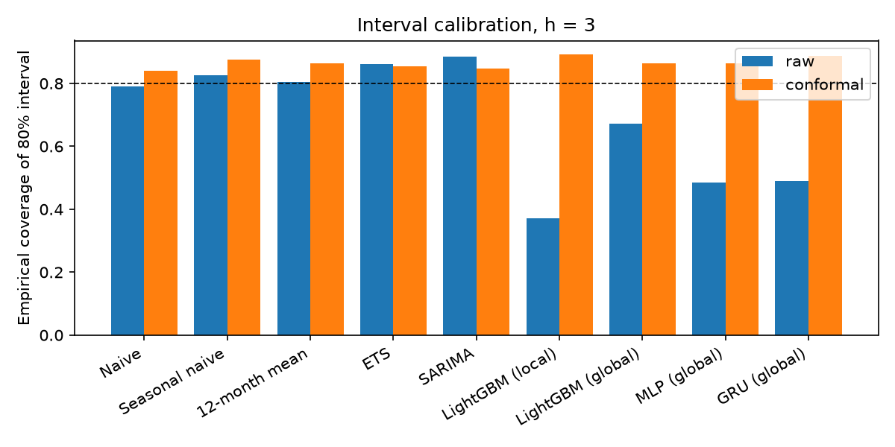
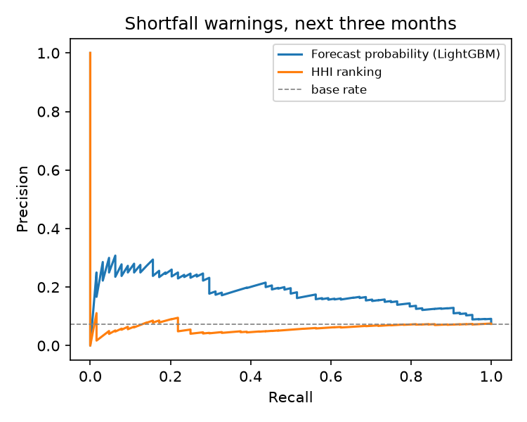
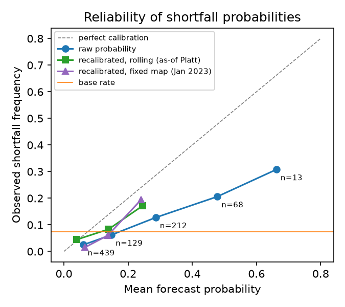
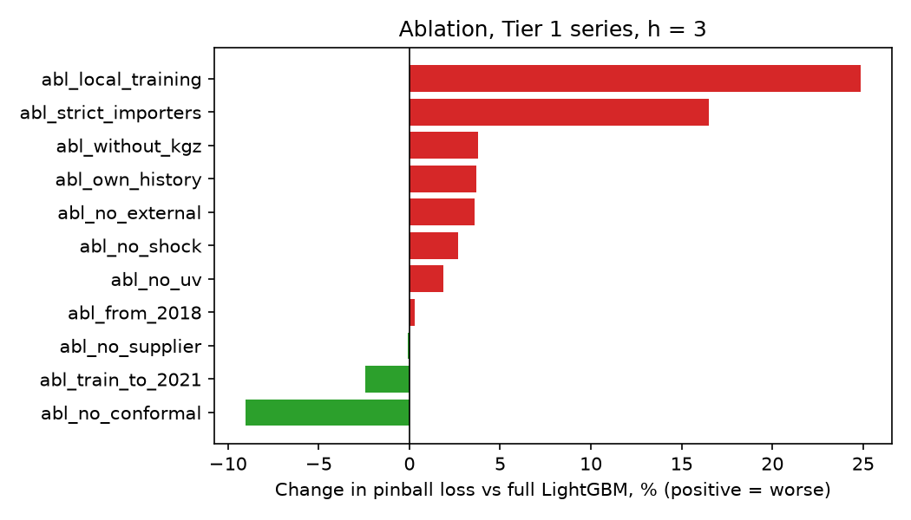
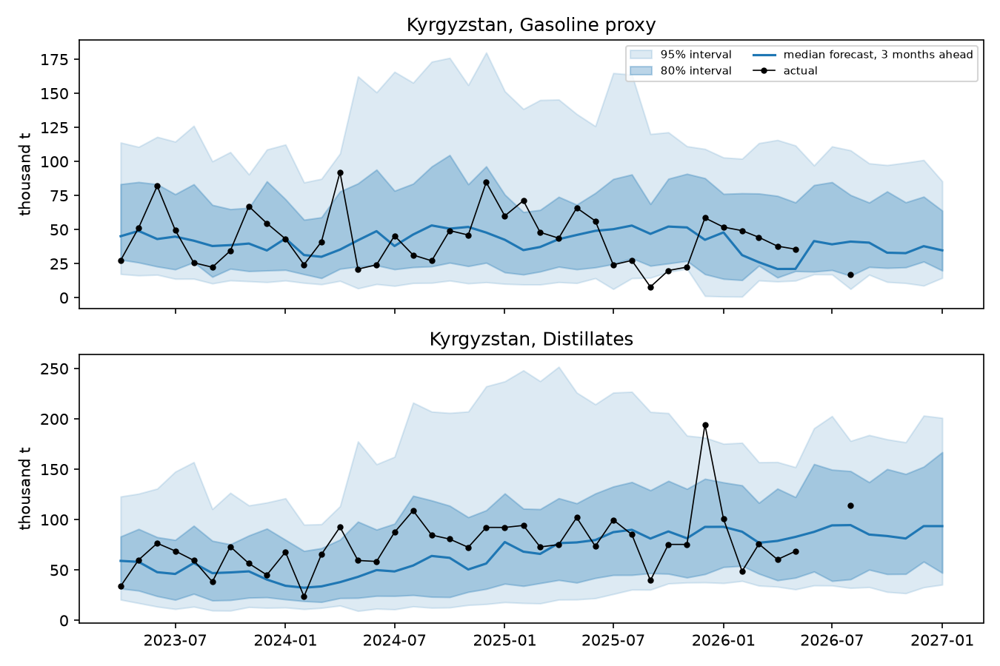

# Phase 3 results: forecasting and shortfall risk

Generated by `python run.py evaluate` (rules v1.0). Rolling origins from 2023-01-01 to 2026-07-01
(43 monthly origins), Tier 1 series unless stated. Every number below is computed from
`data/modeling/forecasts_raw.parquet`; the tables are in `tables/` and the figures in `figures/`.

Forecasts use only data released by each origin. Intervals are conformally adjusted on the 24 previous origins.
MASE is scaled by each series' in-sample seasonal difference, so 1.0 equals the historical error of a
seasonal-naive forecast; values below 1 are better.

## Hypotheses

Holm-adjusted p-values over the four primary tests. Null results are reported with the same weight as positive ones.
Result is the relative improvement of the first model over the second: positive means the first model is better, negative means worse.
p is one-sided (first model better).

| Hypothesis | Test | Result | p (raw) | p (Holm) | Verdict |
|---|---|---|---|---|---|
| H1: global cuts Kyrgyz MASE ≥5% vs best local, h=3 | LightGBM global vs LightGBM, local | -13.8% (95% CI -26.0% to +1.5%) | 0.943 | 1.000 | **not supported** |
| H2: neural not better overall, better in shock windows | MLP, global vs LightGBM global, MASE h=3 | overall -12.0% (p=0.980); shock -12.1% on 111 cases | 0.999 | 1.000 | **not supported** |
| H3: supplier + shock data cut pinball ≥3% on high-dependence series | LightGBM global vs own-history LightGBM | +4.5% (95% CI -3.0% to +12.4%) | 0.163 | 0.490 | **not supported** |
| H4: forecast probability beats HHI ranking | PR-AUC and recall at 10% alert budget | PR-AUC 0.190 vs 0.065 (base rate 0.074); recall 0.30 vs 0.08 | <0.001 | <0.001 | **supported** |

High-dependence series for H3 (largest supplier ≥70% before 2023): ARM:gasoline, AZE:gasoline, CHE:gasoline, KAZ:middle_incl_blends, KGZ:gasoline, KGZ:middle_incl_blends, LAO:gasoline, LAO:middle_incl_blends, LUX:middle_incl_blends, MDA:gasoline, MKD:gasoline, MKD:middle_incl_blends, RWA:gasoline, ZMB:gasoline, ZMB:middle_incl_blends, ZWE:gasoline, ZWE:middle_incl_blends.
The neural candidate for H2 (MLP, global) was chosen on the 2021-2022 calibration origins, before the test block.
Shock windows are documented supply-shortfall events from `config/shock_events.csv` plus two months; the test block has
104 shock cases at h=3, so H2's shock comparison has low power.

## Point accuracy (MASE)

Cases where every model produced a forecast.

| model | m1 | m3 | m6 | sum3 |
|---|---|---|---|---|
| Naive | 1.200 | 1.264 | 1.297 | 1.416 |
| Seasonal naive | 1.136 | 1.137 | 1.148 | 1.075 |
| 12-month mean | 0.947 | 0.989 | 1.036 | 1.006 |
| ETS | 0.964 | 0.983 | 0.990 | 1.148 |
| SARIMA | 1.007 | 1.059 | 1.069 | 1.335 |
| LightGBM, local | 0.974 | 0.982 | 1.011 | 1.009 |
| LightGBM, global | 0.929 | 0.976 | 1.015 | 0.981 |
| MLP, global | 1.017 | 1.064 | 1.121 | 1.049 |
| GRU, global | 1.032 | 1.092 | 1.154 | 1.072 |

## Probabilistic accuracy and calibration, h = 3

Pinball loss is scaled like MASE. Coverage should be close to 0.80 and 0.95.

| model | pinball | cover80_raw | cover80 | cover95_raw | cover95 | width80 |
|---|---|---|---|---|---|---|
| Naive | 1.795 | 0.791 | 0.840 | 0.946 | 0.991 | 23.304 |
| Seasonal naive | 2.460 | 0.825 | 0.875 | 0.946 | 0.985 | 30.984 |
| 12-month mean | 1.313 | 0.805 | 0.864 | 0.962 | 0.992 | 19.799 |
| ETS | 0.404 | 0.862 | 0.855 | 0.962 | 0.966 | 7.203 |
| SARIMA | 0.472 | 0.885 | 0.848 | 0.959 | 0.972 | 8.824 |
| LightGBM, local | 0.305 | 0.371 | 0.892 | 0.641 | 0.981 | 5.203 |
| LightGBM, global | 0.244 | 0.672 | 0.864 | 0.897 | 0.978 | 3.925 |
| MLP, global | 0.315 | 0.485 | 0.864 | 0.672 | 0.981 | 5.301 |
| GRU, global | 0.335 | 0.489 | 0.888 | 0.705 | 0.986 | 5.832 |

## Normal and shock windows, h = 3 (MASE)

| model | normal | shock |
|---|---|---|
| Naive | 1.253 | 1.327 |
| Seasonal naive | 1.086 | 1.450 |
| 12-month mean | 0.976 | 1.070 |
| ETS | 0.947 | 1.204 |
| SARIMA | 0.988 | 1.489 |
| LightGBM, local | 0.951 | 1.170 |
| LightGBM, global | 0.963 | 1.053 |
| MLP, global | 1.046 | 1.174 |
| GRU, global | 1.071 | 1.216 |

## Shortfall warnings (H4 and sensitivity)

Shortfall: the next-three-month mean falls below the threshold share of its seasonal baseline (proposal eq. 2).
The probability comes from the conformal LightGBM forecast distribution (eq. 3); HHI is the trailing 12-month index at the origin.

| Label | Positives / cases | PR-AUC forecast | PR-AUC HHI | PR-AUC top-supplier share | Brier | Recall forecast | Recall HHI | p |
|---|---|---|---|---|---|---|---|---|
| flag_75 | 64 / 861 | 0.190 | 0.065 | 0.090 | 0.081 | 0.30 | 0.08 | <0.001 |
| flag_70 | 45 / 861 | 0.148 | 0.048 | 0.066 | 0.061 | 0.31 | 0.09 | 0.006 |
| flag_80 | 95 / 861 | 0.234 | 0.089 | 0.106 | 0.110 | 0.25 | 0.06 | <0.001 |
| supply_side | 34 / 861 | 0.098 | 0.037 | 0.055 | 0.068 | 0.32 | 0.06 | 0.113 |
| shock | 126 / 861 | 0.387 | 0.107 | 0.129 | 0.109 | 0.30 | 0.00 | <0.001 |

`flag_75` is the primary label; `flag_70` and `flag_80` change the threshold; `supply_side` adds the unit-value condition;
`shock` uses the documented event calendar instead of the volume rule. The Phase 2 event check found the volume labels a weak
proxy (`reports/phase2/event_validation.md`), so the event-based row matters as much as the primary one.

Ranking and calibration are separate properties. The reliability diagram shows whether a stated probability matches
the observed frequency; a Brier score above the base-rate Brier (base rate × (1 − base rate)) means the probabilities
are worse than always predicting the base rate, even if they rank cases well.

### Recalibrated probabilities (post-hoc extension, not part of H1-H4)

Added on 2026-11-25 after the reliability diagram showed overstated risk (`docs/decision_log.md`). Platt scaling on past
outcomes that had been released by each origin, pooled over all 44 series and 24 origins. *Rolling* refits the map every
origin; *fixed* fits it once at the first test origin and keeps it. Same cases for all three rows.

| Label | Probability | Mean p | Base rate | Brier | Base-rate Brier | PR-AUC | Recall |
|---|---|---|---|---|---|---|---|
| flag_75 | raw | 0.171 | 0.074 | 0.0806 | 0.0688 | 0.190 | 0.30 |
| flag_75 | rolling | 0.100 | 0.074 | 0.0697 | 0.0688 | 0.137 | 0.22 |
| flag_75 | fixed | 0.140 | 0.074 | 0.0688 | 0.0688 | 0.190 | 0.30 |
| flag_70 | raw | 0.136 | 0.052 | 0.0612 | 0.0495 | 0.148 | 0.31 |
| flag_70 | rolling | 0.076 | 0.052 | 0.0511 | 0.0495 | 0.106 | 0.22 |
| flag_70 | fixed | 0.109 | 0.052 | 0.0504 | 0.0495 | 0.148 | 0.31 |
| flag_80 | raw | 0.214 | 0.110 | 0.1104 | 0.0982 | 0.234 | 0.25 |
| flag_80 | rolling | 0.134 | 0.110 | 0.0972 | 0.0982 | 0.186 | 0.22 |
| flag_80 | fixed | 0.183 | 0.110 | 0.0979 | 0.0982 | 0.234 | 0.25 |

Recalibration removes most of the overstatement, but no version is meaningfully better than the base rate on the
Brier score (the largest gain is about 0.001): the forecast carries ranking information, not a reliable probability level. The rolling map is monotone within an
origin, so it keeps each month's ranking (what the monitor shows); refitting changes the scale between origins,
which lowers the pooled PR-AUC. The monitor shows the rolling recalibrated probability.

## Ablation (LightGBM global, h = 3)

One change at a time. Positive change means the variant is worse than the full model.
`abl_without_kgz` is scored on Kyrgyz series only (leave-one-country-out); `abl_strict_importers` on strict-importer series only.
`abl_no_conformal` compares raw with conformal intervals of the same model, so its MASE does not change.

| variant | cases | mase_change | pinball_change | cover80 |
|---|---|---|---|---|
| abl_from_2018 | 867 | -0.1% | +0.3% | 0.877 |
| abl_no_external | 867 | -1.4% | +3.6% | 0.879 |
| abl_no_shock | 867 | +1.1% | +2.7% | 0.869 |
| abl_no_supplier | 867 | -2.4% | -0.1% | 0.860 |
| abl_no_uv | 867 | -0.3% | +1.9% | 0.862 |
| abl_own_history | 867 | -3.1% | +3.7% | 0.886 |
| abl_strict_importers | 540 | -0.3% | +16.5% | 0.935 |
| abl_train_to_2021 | 867 | -2.6% | -2.4% | 0.877 |
| abl_without_kgz | 78 | +2.2% | +3.8% | 0.744 |
| abl_no_conformal | 867 | +0.0% | -9.1% | 0.675 |
| abl_local_training |  | +0.8% | +24.9% | 0.893 |

## Kyrgyzstan

Per-product accuracy for Kyrgyzstan: `tables/accuracy_kyrgyzstan.csv`.

## Limits of this run

- One Comtrade snapshot (2026-11-02). Release dates are those of the current record, so older months may carry revised values; revisions cannot be measured until a second snapshot exists.
- Shortfall labels are descriptive and weak (Phase 2); results for H4 depend on which label is used.
- Random forest, XGBoost, TCN, N-BEATS proper and the Temporal Fusion Transformer from the proposal were not run; the neural arm is a residual MLP and a GRU of the same size class.
- Hyperparameters are fixed defaults from `config/settings.yaml`, not tuned.
- Cleaning rules and tier thresholds are frozen as v1.0 without supervisor review yet (`docs/decision_log.md`).
