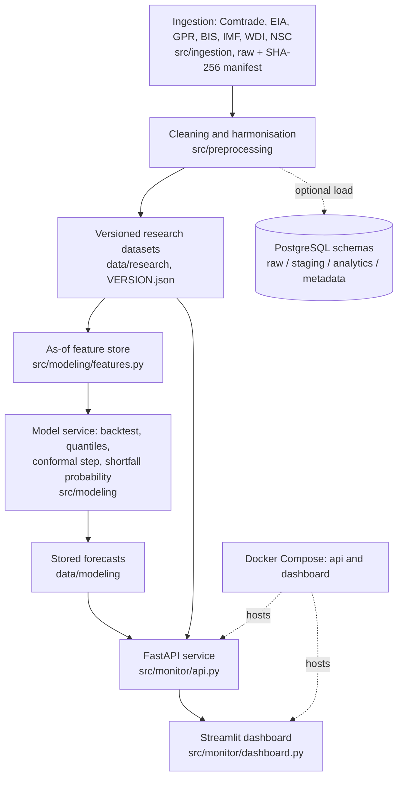

# Section 3. Methods and Material

> **AI-ASSISTED DRAFT (working material, not final text).** Drafted by an AI research assistant from the repository documentation (`docs/methodology.md`, `docs/decision_log.md`, `config/settings.yaml`, `src/`), the approved proposal and `.claude/research_decisions.md`. The student must rewrite it, verify every statement against the code, and be able to explain it at the defence. The faculty caps plagiarism plus AI-generated content at 30%. Citation style: APA 7. Project numbers come from `petroleum-import-risk/` files named in the text. Anything unverifiable is tagged `[UNVERIFIED: ...]`; money and hours that only the student can supply are tagged `[COST TO BE CONFIRMED BY STUDENT: ...]` or `[TO BE FILLED BY STUDENT]`.

## 3.1 Data sources and the as-of (pseudo-real-time) design

**Target data.** Monthly bilateral imports by six-digit HS code come from the UN Comtrade API (snapshot `2026-11-02`, dataset v1.0.0). The screening window is January 2015 to August 2026. The snapshot holds 878 raw responses (878 lines in `petroleum-import-risk/data/raw/un_comtrade/2026-11-02/manifest.jsonl`), each stored unmodified with its retrieval date and SHA-256 hash in a JSONL manifest; all hashes match. A new data vintage means a new `snapshot_id`, and older snapshots are never altered.

**Covariates.** Table 3.1 lists the sources (`docs/data_sources.md`). Annual series are used for validation and description only; they never enter features, and annual values are never spread across months.

| Source | Use |
|---|---|
| UN Comtrade, monthly HS6 | Targets, supplier shares |
| US EIA, Brent and WTI spot (public files) | External indicator |
| Geopolitical Risk index (Caldara & Iacoviello, 2022) | External indicator |
| BIS exchange rates; IMF CPI | External indicators |
| Kyrgyz National Statistical Committee: fuel and energy balance; import tables; monthly express reports | Validation, Kyrgyz dependency, vintage check |
| World Bank WDI (annual) | Descriptive only |
| Shock calendar `config/shock_events.csv` (37 sourced events) | Shock features from the announcement date; event validation of labels |

*Table 3.1. Data sources.*

**The as-of rule.** An observation is visible at forecast origin month M only if its `first_released` date is on or before the last day of M. External indicators are shifted by their release delay (Brent, GPR and Russia GPR by one month; exchange rates and CPI by two). A shock enters the information set only from its announcement date. Because of publication lag, a one-month-ahead forecast usually lies three to four months beyond the last visible observation. This is the realistic definition of the forecasting task (Stark & Croushore, 2002; Croushore, 2006).

**Deviation from the proposal.** The proposal promised evaluation on first-release data. The v1.0 data hold the latest value of each record as of 2 November 2026, and `first_released` is the release date of the current record, so the rule can hide data that existed earlier in another form but never reveals data early. The design is therefore called *pseudo-real-time with release-lag emulation*, not real-time. A second raw snapshot (2026-11-25) was pulled to measure revisions: over 23 days 24 of 5,536 months (0.43%) changed, with a median revision of 1.22% among changed months, and Kyrgyzstan was not revised (`reports/phase3/vintage_comparison.md`). This is only a lower bound, since national statistics later put Kyrgyz imports about 9% above the first releases. This 9% is the median for all goods; the effect on fuel is unknown (`reports/phase2/unresolved_issues.md`, item 1). Also, Kyrgyz 2025-26 values should be read with that warning.

## 3.2 Cleaning and target construction

**Mass rules** (`docs/methodology.md`; thresholds in `config/settings.yaml`):

- Mass is the net weight when positive. Otherwise the quantity fields are used only when their unit is kilograms. Where a volume is reported on the same row, the implied density must be plausible (gasoline 0.68-0.80, LPG 0.48-0.62, other products 0.60-1.05 kg/L).
- Litres and trade value are never converted into `import_mass_t`. Volume-based estimates sit in separate, labelled columns.
- Monthly totals are the sum of partner rows. The "World" row is only a check or a labelled fallback (`total_source`), and the two are never added. The 2710 heading is never summed with its six-digit lines, and crude is never combined with refined products.
- **No imputation.** Absent months stay absent: no interpolation and no zero-filling. Each month carries a status (`usable`, `unit_value_rejected`, `value_without_mass`, `published_product_absent`, `not_published`), and absent months are excluded from training loss and scoring.
- A Brent-deflated unit value below 0.5 times its centred 13-month median removes the mass but keeps the record; above 2.0 it only flags. Outliers beyond four robust standard deviations on log mass are flagged but kept, because shocks are the object of study.

**Leakage note.** The centred median looks at future months, so it can influence the visible history. The published `uv_relative` is never a feature. The rule rejected no Tier 1 month in the test period and 23 earlier ones (`.claude/phase0_audit.md`, item 3.2), but a sensitivity run without the rule is still planned (R5).

**Tiers** (`screening` in `config/settings.yaml`). Tier 1 requires at least 120 observed months, a mass share of at least 0.95 and no gap longer than six months; Tier 2 requires at least 60 months and a mass share of 0.80. Tier 3 is descriptive. Tier 1 is evaluated, Tiers 1 and 2 train the global models. The tiers were selected on the full 2015-2026 window, which includes the test block (limitation; re-screening on data to 2022 is planned).

**Targets.** The forecast target is `log1p(mass) minus level`, where `level` is the mean log mass of the last 12 visible months (at least 6). Forecasts are converted back to tonnes with the same level, so one global model can serve series of any size.

**Import-shortfall signal.** For series i and target month t, Q is the mean mass of the three months ending at t, and B is the mean of the same three calendar months in the previous three years (missing years skipped). The primary label is S = 1[Q/B < 0.75]. Pre-specified sensitivities use 0.70 and 0.80; a supply-side label also requires a rising Brent-deflated unit value; an event label uses the shock calendar. The label is a volume-based proxy for supply stress. It does not include stocks, consumption or domestic production, so it also fires on falls in demand, stock drawdowns, a shift to domestic refining and recording artefacts. The Phase 2 check found that the volume labels fired in 13 of 33 documented supply events (`reports/phase2/event_validation.md`).

**Interpretation limits for Kyrgyzstan.** Kyrgyz domestic production supplies 23-33% of gasoline in 2016-2018 and 2024 but only 2-5% in 2020-2023, and stocks reach up to 4.5 months (`reports/phase2/tables/kyrgyz_import_dependency.csv`), so a 25% fall in three-month imports need not mean a physical shortage. Kyrgyz fuel-oil imports rose from 0.2 kt (2021) to 176.3 kt (2024), which sit inside HS 271019, so Kyrgyz "distillates" results may reflect fuel oil for heating or power. Gasoline mass agrees with the national energy balance within a mean absolute 3.7% from 2018.

## 3.3 Features and leakage controls

Each feature row is built per (origin, series, horizon) from visible data only. The groups are:

- **Own history:** 18 monthly lags before and including the origin month, last one and last three months, same-month values one and two years back, months since the last visible value, visible count over 24 months, volatility, month-of-year sine and cosine, horizon indicator, and a distillates indicator.
- **Supplier structure:** trailing-12-month HHI (at least six observed months), largest-supplier share, Russia share. HHI is the sum of squared partner shares of pooled mass.
- **External:** log Brent, Brent change over 3 and 12 months, global and Russia GPR, exchange-rate and CPI changes, each lagged by its release delay.
- **Shocks:** supply-shock active, recent, and demand-shock active, counted only from the announcement date.
- **Unit value:** `uv_asof`, the latest visible Brent-deflated unit value against the median of the last 12 visible months.

Leakage controls: the as-of rule above; same-month unit values and look-ahead cleaning fields excluded; annual covariates excluded; normalisation and tuning fitted on past data only; and unit tests that check visibility (`tests/test_modeling.py`). Residual risks are stated: the shock exposure share is computed over the 12 months before an event, some of which may not have been released at announcement, and supplier shares use the final vintage.

## 3.4 Models

Models are introduced in order of increasing complexity so that each addition can be measured. Forecasts are quantiles at 0.025, 0.1, 0.5, 0.9 and 0.975 for horizons of one, three and six months after the origin month, and for the mean of months one to three ("sum3").

1. **Local baselines:** naive; seasonal naive; 12-month mean; ETS (fitted on the latest unbroken run of at least 36 months); SARIMA(0,1,1)(0,1,1)12 on log mass. Baselines are lower bounds that any learned model must beat.
2. **LightGBM** (Ke et al., 2017) with quantile objectives, in a *local* version (one model per series) and a *global* version trained on the pooled Tier 1 and Tier 2 panel. Settings: 300 trees, learning rate 0.05, 15 leaves, subsample 0.8.
3. **Neural models,** both global and small: a residual MLP (an N-BEATS-style stack of blocks) and a GRU, each with 64 hidden units, a country embedding of size 8, dropout 0.1 and 60 epochs, averaged over five seeds. For H2, the neural candidate was chosen on the 2021-2022 calibration origins, before the test block.

Global learned models are refitted every third origin. Hyperparameters are fixed defaults, identical in budget across learned models, not tuned. **Scope statement:** random forest, XGBoost, TCN, full N-BEATS and the Temporal Fusion Transformer from the proposal were not run, and the proposal allowed the TFT to be dropped. Conclusions about "neural models" therefore concern this MLP and GRU only. The choice of global modelling follows the literature on cross-learning (Montero-Manso & Hyndman, 2021), and the case for pooling short panels is an empirical question that H1 tests.

## 3.5 Calibration, the import-shortfall signal and its probability

**Conformalised quantile regression.** Raw quantile forecasts are adjusted with CQR (Romano et al., 2019) per model and horizon, pooled across series. At origin t, the scores s = max(lower - y, y - upper) are taken from the previous 24 origins whose targets had been released by t, with at least 30 scores. The 80% and 95% interval pairs are then widened or narrowed by the conformal quantile of these scores, and the quantiles are sorted to remove crossings. Calibration is needed: before adjustment, the 80% coverage at h = 3 is 0.672 for global and 0.371 for local LightGBM (`reports/phase3/results.md`).

**Shortfall probability.** No separate classifier is trained on the rare, unverified labels. The probability follows from the forecast distribution of Q: p = Pr(Q/B < 0.75 given the information at the origin). It is computed from the conformal quantiles of the "sum3" forecast and the as-of seasonal baseline, using a predictive distribution that is linear between the stored quantiles with normal tails fitted to the outer quantiles. Realised labels use final data. Thresholds 0.70 and 0.80 give the sensitivities.

**Post-hoc recalibration (exploratory).** After the test results showed that raw probabilities overstated risk, a Platt map was added (logistic regression on logit(p), fitted at each origin on the previous 24 origins with released outcomes; at least 10 events and 10 non-events). It was decided after seeing the test block and is not part of H1-H4: H4 is tested on the raw probability. The monitor shows the rolling recalibrated value; whether this stays is an open decision (R7).

## 3.6 Evaluation protocol and statistics

**Origins.** Expanding rolling origins, one per month. Origins from 2021-01 to 2022-12 feed only the conformal step and the neural-model choice. The test block runs from 2023-01 to 2026-07 (43 origins). No random splits are used (Tashman, 2000). Every forecast is stored with its origin date and model version.

**Metrics.**

- *Point:* MASE (primary; Hyndman & Koehler, 2006), scaled by the in-sample seasonal difference of period 12 of each series' visible months, so that 1.0 equals the historical error of a seasonal-naive forecast; also WAPE, RMSE, MAE. MAPE and R-squared are not used.
- *Quantile:* pinball loss, scaled like MASE, and a CRPS approximation from the five stored quantiles (Gneiting & Raftery, 2007), which runs about 11% below the exact value for a normal forecast and is used for ranking only.
- *Interval:* empirical coverage at 80% and 95%, mean width, quantile hit rates and the probability integral transform.
- *Shortfall:* PR-AUC (Saito & Rehmsmeier, 2015), Brier score (Brier, 1950) against the base-rate Brier, and recall at a 10% alert budget.

**Tests.** Pairs of forecasts are compared with the Harvey-Leybourne-Newbold corrected Diebold-Mariano test (Diebold & Mariano, 1995; Harvey et al., 1997). The four primary tests are adjusted with Holm (1979). Intervals for effect sizes and for H4 come from a moving-block bootstrap (blocks of six origins, 2,000 resamples, seed 0), one-sided. Effect sizes are always reported next to p-values. Exploratory comparisons (H4 benchmarks R1, importer-type strata R2, recalibration) are not Holm-adjusted and are labelled as such.

**Known features of the design.** For H1, the best local model is chosen on the test block, which favours the local side. Cases overlap across origins and series, so H4's 861 cases contain only 28 episodes in 12 series; the 41 or so Kyrgyz H1 cases give low power. Strata by importer type use hand-assigned, unsourced types.

## 3.7 System architecture of the Fuel Import Risk Monitor

*Figure 3.1. Layers of the Risk Monitor. Data flow is strictly forward.*

- **Ingestion** (`src/ingestion`): a Comtrade client with header authentication, retries and checkpointing, and external-data clients. Keys come from `.env`, are sent in a header and masked in logs.
- **Cleaning and research datasets** (`src/preprocessing`, `src/research`): the rules of Section 3.2, producing Datasets A-D and the versioned research files with a transformation log.
- **PostgreSQL** (`sql/schema.sql`, `src/database`): four schemas (raw, staging, analytics, metadata) and a loader (`run.py load`), checked by a smoke test on an embedded throwaway PostgreSQL. The honest status: the monitor currently reads Parquet and CSV files, not the database, so PostgreSQL is an optional persistence layer.
- **Feature store and model service** (`src/modeling`): features.py, baselines.py, learners.py, backtest.py, calibrate.py, evaluate.py. Every number the monitor shows comes from stored model output.
- **FastAPI** (`src/monitor/api.py`): endpoints `/health`, `/series`, `/risk`, `/forecast/{iso3}/{product}`, `/suppliers/{iso3}/{product}`, `/events/{iso3}`, `/performance`, with request logging and self-generated documentation.
- **Streamlit** (`src/monitor/dashboard.py`): a client that talks only to the API; fan chart, risk status, supplier mix and event timeline. Status bands are amber from a probability of 0.20 and red from 0.40.
- **Docker Compose:** two services, `api` (port 8000, with a health check) and `dashboard` (port 8501), built from one image on `python:3.11-slim`, running as a non-root user, with `data/` and `reports/` mounted read-only. There is no authentication and ports are published on all interfaces, so this is a local-use configuration.

Because of publication lag, the system gives an early signal, not a live feed.

## 3.8 Facilities and infrastructure

Only verifiable facts are stated.

- **Hardware and OS:** a Windows 11 workstation with 12 CPU cores (`petroleum-import-risk/README.md`). `[TO BE CONFIRMED BY STUDENT: CPU model, RAM, disk, whether a GPU exists; the CPU build of PyTorch is sufficient.]`
- **Software:** Python 3.11.5 (virtual environment `.venv`, see `.venv/pyvenv.cfg`; Docker image `python:3.11-slim`). Libraries in `requirements.txt` (minimum versions, no lockfile yet): pandas, numpy, pyarrow, scipy, statsmodels, scikit-learn, lightgbm, torch, ruptures, matplotlib, requests, pyyaml, sqlalchemy, psycopg2-binary, fastapi, uvicorn, streamlit, plotly, httpx, pytest, and pgserver for tests.
- **Data access:** the Comtrade free tier allows 500 calls a day with a key and one call per 1.2 seconds (`config/settings.yaml`, published limits checked 2026-11-02). Without a key the keyless preview endpoint is limited to 500 records per call and is throttled; the panel then needs about 3,780 calls instead of about 324.
- **Runtimes:** the README states that the full backtest takes about 15-30 minutes on 12 cores, with SARIMA and neural models slowest. `[UNVERIFIED: figures of about 25 minutes for the full backtest and 2-3 minutes for the evaluation stage were supplied in the drafting brief but are not in the repository; the student should time and record them]`.
- **Quality assurance:** 77 automated tests pass (`pytest -q tests`, verified in the Phase 0 audit) plus a database smoke test.
- **Reproducibility:** all stages resume from checkpoints; tables and figures are regenerated by scripts. Raw, analytical and research data are git-ignored, so a fresh clone needs a new pull or an archived copy (open item).

## 3.9 Minimum viable product (MVP)

**What the prototype does now.** From stored model output, for each Tier 1 series it displays: forecast fans (quantiles) for the target product; an import-shortfall-signal status with the probability of a three-month mean below 75% of its seasonal baseline; the supplier mix and concentration; the documented shock events; and a performance page. It runs locally through two commands or `docker compose up --build`.

**What it explicitly does not claim.**

- It does not give a probability of physical shortage. The accurate description is a *ranked watch-list of unusual import declines against a seasonal baseline*, with the data age stated.
- Raw probabilities overstate risk (mean 0.171 against a base rate of 0.074), and the recalibrated version has no meaningful Brier skill over the base rate (`reports/phase3/results.md`). The probability level is therefore not a reliable frequency. The red band is reached by very few cases, none of them with an observed shortfall (`reports/phase3/tables/shortfall_calibration.csv`; Phase 0 audit item 2.4).
- It does not show stocks, consumption or retail availability, and it cannot check the 2026 Bishkek gasoline shortage, because no Comtrade data for June-July 2026 exist `[UNVERIFIED: case not checkable with current data]`.
- Some dashboard wording ("Shortfall risk") predates decision R2 and must be renamed.

## 3.10 Budget and resources ("Funds")

Data and software costs are zero, as far as verified. Costs that cannot be verified are left for the student.

| Item | Cost | Source or status |
|---|---|---|
| UN Comtrade API, free-tier key | Free | README; `config/settings.yaml` (tier limits checked 2026-11-02) |
| EIA, Geopolitical Risk index, BIS, IMF, World Bank WDI, Kyrgyz NSC publications | Free, public | `docs/data_sources.md` |
| Python and open-source libraries (PyPI) | Free | `requirements.txt` `[UNVERIFIED: each licence not audited]` |
| Workstation (existing) | `[COST TO BE CONFIRMED BY STUDENT: depreciation or none]` | not verified |
| Electricity for compute | `[COST TO BE CONFIRMED BY STUDENT: electricity]` | compute time about 15-30 minutes per full backtest (README) |
| Hosting for a public deployment | `[COST TO BE CONFIRMED BY STUDENT: hosting]` | not yet decided |
| Domain name | `[COST TO BE CONFIRMED BY STUDENT: domain]` | not yet decided |
| Comtrade premium or other paid data | `[COST TO BE CONFIRMED BY STUDENT: paid data, if any]` | not used so far |
| AI assistant subscription | `[COST TO BE CONFIRMED BY STUDENT: AI tool subscription]` | not verified |

*Table 3.2. Cost items.*

**Resource calculations that can be verified.** The panel pull needs about 324 keyed calls, which is 0.65 of one day's 500-call free quota; the second snapshot needed 264 tasks (244 returned data, 20 were empty), 0.53 of one day's quota (`.claude/phase0_audit.md`). Raw storage size `[TO BE FILLED BY STUDENT: GB of data/raw and data/research]`.

| Work package | Planned hours | Actual hours |
|---|---|---|
| Data acquisition and validation (Phases 1-2) | [TO BE FILLED BY STUDENT] | [TO BE FILLED BY STUDENT] |
| Feature store, models, calibration (Phase 3) | [TO BE FILLED BY STUDENT] | [TO BE FILLED BY STUDENT] |
| Evaluation and robustness | [TO BE FILLED BY STUDENT] | [TO BE FILLED BY STUDENT] |
| Monitor (API, dashboard, Docker) | [TO BE FILLED BY STUDENT] | [TO BE FILLED BY STUDENT] |
| Literature review and thesis writing | [TO BE FILLED BY STUDENT] | [TO BE FILLED BY STUDENT] |
| Article preparation | [TO BE FILLED BY STUDENT] | [TO BE FILLED BY STUDENT] |

*Table 3.3. Person-hours.*

---

## References (APA 7; as listed in the approved proposal or in `section1_literature_review.md`)

Brier, G. W. (1950). Verification of forecasts expressed in terms of probability. *Monthly Weather Review, 78*(1), 1-3.

Caldara, D., & Iacoviello, M. (2022). Measuring geopolitical risk. *American Economic Review, 112*(4), 1194-1225. https://doi.org/10.1257/aer.20191823

Croushore, D. (2006). Forecasting with real-time macroeconomic data. In *Handbook of economic forecasting* (pp. 961-982). Elsevier. https://doi.org/10.1016/S1574-0706(05)01017-7

Diebold, F. X., & Mariano, R. S. (1995). Comparing predictive accuracy. *Journal of Business & Economic Statistics, 13*(3), 253-263. https://doi.org/10.1080/07350015.1995.10524599

Gneiting, T., & Raftery, A. E. (2007). Strictly proper scoring rules, prediction, and estimation. *Journal of the American Statistical Association, 102*(477), 359-378. https://doi.org/10.1198/016214506000001437

Harvey, D., Leybourne, S., & Newbold, P. (1997). Testing the equality of prediction mean squared errors. *International Journal of Forecasting, 13*(2), 281-291. https://doi.org/10.1016/S0169-2070(96)00719-4

Holm, S. (1979). A simple sequentially rejective multiple test procedure. *Scandinavian Journal of Statistics, 6*(2), 65-70. [UNVERIFIED: not checked against Crossref; no DOI in the proposal list]

Hyndman, R. J., & Koehler, A. B. (2006). Another look at measures of forecast accuracy. *International Journal of Forecasting, 22*(4), 679-688. https://doi.org/10.1016/j.ijforecast.2006.03.001

Ke, G., Meng, Q., Finley, T., Wang, T., Chen, W., Ma, W., Ye, Q., & Liu, T.-Y. (2017). LightGBM: A highly efficient gradient boosting decision tree. In *Advances in Neural Information Processing Systems* (Vol. 30, pp. 3146-3154). [UNVERIFIED: not checked against Crossref]

Montero-Manso, P., & Hyndman, R. J. (2021). Principles and algorithms for forecasting groups of time series: Locality and globality. *International Journal of Forecasting, 37*(4), 1632-1653. https://doi.org/10.1016/j.ijforecast.2021.03.004

Romano, Y., Patterson, E., & Candès, E. J. (2019). *Conformalized quantile regression*. arXiv. https://doi.org/10.48550/arxiv.1905.03222

Saito, T., & Rehmsmeier, M. (2015). The precision-recall plot is more informative than the ROC plot when evaluating binary classifiers on imbalanced datasets. *PLoS ONE, 10*(3), e0118432. https://doi.org/10.1371/journal.pone.0118432

Stark, T., & Croushore, D. (2002). Forecasting with a real-time data set for macroeconomists. *Journal of Macroeconomics, 24*(4), 507-531. https://doi.org/10.1016/S0164-0704(02)00062-9

Tashman, L. J. (2000). Out-of-sample tests of forecasting accuracy: An analysis and review. *International Journal of Forecasting, 16*(4), 437-450. https://doi.org/10.1016/S0169-2070(00)00065-0

*Verification note:* the entries are copied from the existing reference lists; this draft did not re-resolve their DOIs.
